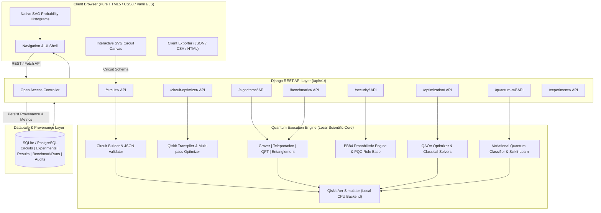
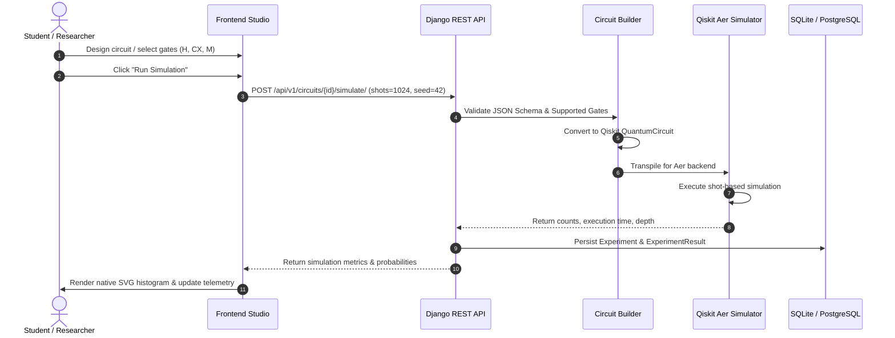
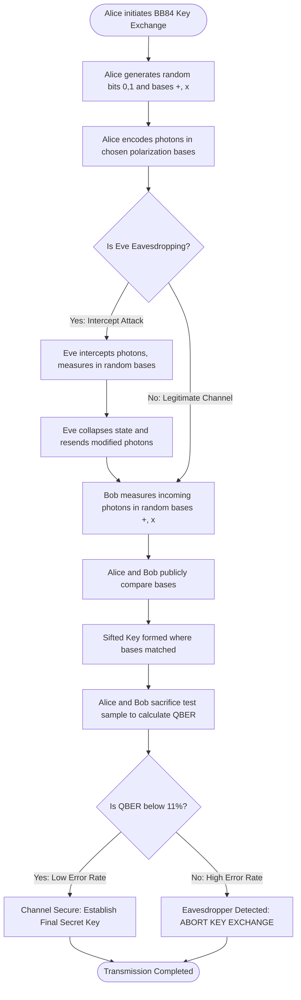
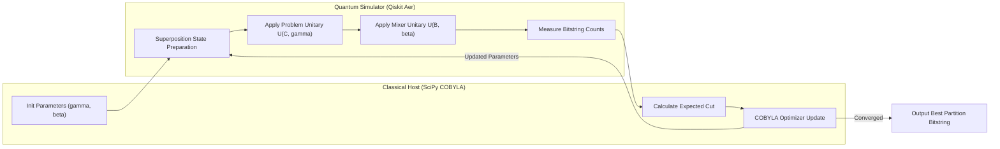
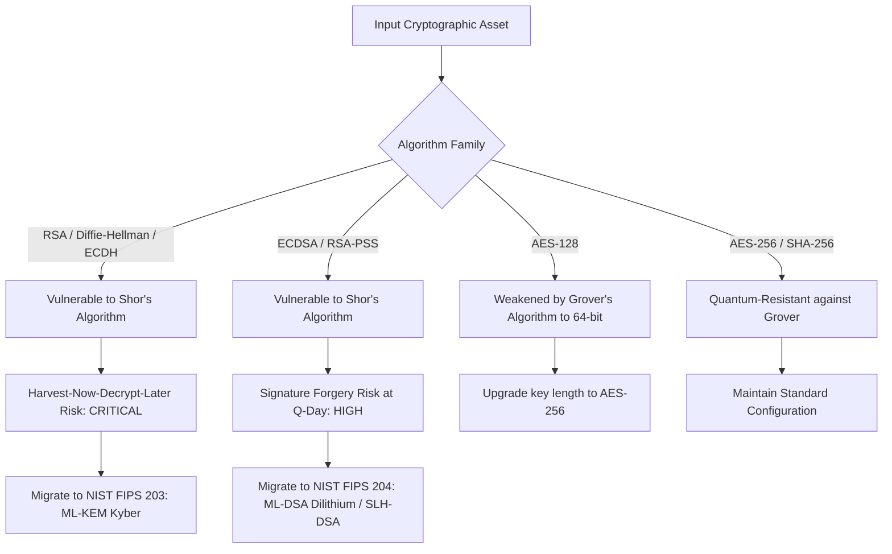

<div align="center">

# ⚛️ QVerse — Quantum Computing Research & Security Platform
### *An Integrated Scientific Workstation for Quantum Simulation, Algorithmic Benchmarking, Post-Quantum Cryptography & Circuit Transpilation*

[](https://www.python.org/)
[](https://qiskit.org/)
[](https://qiskit.org/)
[](https://www.djangoproject.com/)
[](#frontend-architecture)
[](#zero-login-open-access)
[](#automated-testing)

---

**Developed as a B.Tech Final-Year Major Project**  
*Academic Year 2026–2027*

</div>

---

## 📑 Table of Contents
1. [Executive Summary & Problem Statement](#-executive-summary--problem-statement)
2. [Product Vision & Dual-Mode UI](#-product-vision--dual-mode-ui)
3. [Zero-Login Open Access Architecture](#-zero-login-open-access-architecture)
4. [System Architecture & Dataflow](#-system-architecture--dataflow)
5. [The Eight Core Modules](#-the-eight-core-modules)
   - [Module 1: Quantum Circuit Studio](#module-1--quantum-circuit-studio)
   - [Module 2: Quantum Algorithms Laboratory](#module-2--quantum-algorithms-laboratory)
   - [Module 3: Quantum vs Classical Benchmarking](#module-3--quantum-vs-classical-benchmarking)
   - [Module 4: Quantum Security Laboratory (BB84 & PQC)](#module-4--quantum-security-laboratory)
   - [Module 5: Quantum Optimization Lab (QAOA Max-Cut)](#module-5--quantum-optimization-lab)
   - [Module 6: Hybrid Quantum AI Lab (VQC vs Classical ML)](#module-6--hybrid-quantum-ai-lab)
   - [Module 7: Quantum Circuit Optimizer](#module-7--quantum-circuit-optimizer)
   - [Module 8: Experiment Manager & Export Provenance](#module-8--experiment-manager)
6. [Diagrammatic Workflows & Methodologies](#-diagrammatic-workflows--methodologies)
   - [Circuit Execution & Aer Simulation Pipeline](#1-circuit-execution--aer-simulation-pipeline)
   - [BB84 QKD Protocol & Intrusion Detection Flow](#2-bb84-qkd-protocol--intrusion-detection-flow)
   - [QAOA Hybrid Optimization Loop](#3-qaoa-hybrid-optimization-loop)
   - [Post-Quantum Cryptography Migration Decision Tree](#4-post-quantum-cryptography-migration-decision-tree)
7. [Scientific Honesty & Limitations Disclosure](#-scientific-honesty--limitations-disclosure)
8. [Technology Stack & Dependency Matrix](#-technology-stack--dependency-matrix)
9. [Installation & Quick Start Guide](#-installation--quick-start-guide)
10. [Automated Test Suite Verification](#-automated-test-suite-verification)
11. [License & Acknowledgments](#-license--acknowledgments)

---

## 🎯 Executive Summary & Problem Statement

Quantum computing represents an epochal leap in computational capability. By exploiting the quantum mechanical principles of **superposition**, **entanglement**, and **quantum interference**, quantum algorithms offer provable speedups over the best classical algorithms:
- **Grover's Algorithm:** Quadratic speedup ($O(\sqrt{N})$ vs $O(N)$) for unstructured search.
- **Shor's Algorithm:** Polynomial-time integer factorization and discrete logarithms ($O(n^3)$), rendering current public-key cryptography (RSA, Diffie-Hellman, ECDSA) obsolete.
- **Quantum Approximate Optimization Algorithm (QAOA):** Polynomial-depth heuristic for combinatorial optimization (Max-Cut).
- **Variational Quantum Classifiers (VQC):** High-dimensional Hilbert space kernel embeddings for machine learning.

### The Educational & Research Challenge
Existing quantum development tools force learners and students through fragmented, steep learning curves:
1. Command-line-only Python scripts that produce static printouts.
2. Proprietary, cloud-dependent vendor platforms requiring API keys, credit cards, or compute quotas.
3. Mandatory user registrations and login walls that hinder classroom demonstrations and rapid experimentation.
4. "Black-box" simulations that fabricate artificial speedups without disclosing classical CPU simulation overheads.

### The QVerse Solution
**QVerse** is an integrated scientific research workstation designed for engineering students, faculty, and cybersecurity researchers. It combines interactive circuit construction, local quantum execution on **Qiskit Aer**, algorithm demonstrations, hardware transpilation, BB84 quantum key distribution, and NIST-aligned Post-Quantum Cryptography audits in a single, **100% open-access, zero-credential** environment.

---

## 🖥️ Product Vision & Dual-Mode UI

QVerse bridges the gap between modern scientific visualization and rigorous academic research:

```text
               ┌────────────────────────────────────────────────────────┐
               │              QVerse Persistent Workspace              │
               └───────────────────────────┬────────────────────────────┘
                                           │
                    ┌──────────────────────┴──────────────────────┐
                    ▼                                             ▼
       ┌─────────────────────────┐                   ┌─────────────────────────┐
       │   Modern Scientific     │                   │    Minimal Academic     │
       │    Dashboard Mode       │                   │      Research Mode      │
       ├─────────────────────────┤                   ├─────────────────────────┤
       │ • Interactive SVG plots │                   │ • Distraction-free data │
       │ • Live circuit canvas   │                   │ • Mathematical theory   │
       │ • Real-time telemetry   │                   │ • Parameter tables      │
       │ • Color-coded statuses  │                   │ • Provenance notes      │
       └─────────────────────────┘                   └─────────────────────────┘
```

Both interfaces consume identical backend REST endpoints and database models. The user’s preference is persisted in browser storage.

---

## 🔓 Zero-Login Open Access Architecture

To ensure immediate usability for B.Tech students and researchers:
- **No Mandatory Login / Signup:** Every visitor has instant, unhindered access to all eight laboratories.
- **Sandboxed Open Researcher Context:** State-changing requests (saving circuits, launching QAOA runs, exporting benchmark CSVs) automatically bind to an authenticated, isolated `open_researcher` profile managed by `apps.accounts.open_access`.
- **Global REST Policy:** All DRF viewsets and API views enforce `AllowAny` permissions by default.

---

## 🏗️ System Architecture & Dataflow

QVerse follows a modular, decoupled architecture where Django orchestrates client interactions and persists experiment provenance, while the isolated `quantum_engine` manages all scientific computation and simulator interactions:



---

## 🔬 The Eight Core Modules

### Module 1 — Quantum Circuit Studio
- **Route:** `/circuits/`
- **Capabilities:**
  - Dynamic SVG circuit canvas supporting wire scaling (1 to 16 qubits).
  - Gate Palette: `Identity`, `Pauli-X`, `Pauli-Y`, `Pauli-Z`, `Hadamard`, `S`, `S†`, `T`, `T†`, `RX`, `RY`, `RZ`, `Phase`, `CNOT`, `CZ`, `SWAP`, and `Measurement`.
  - OpenQASM 2.0 real-time generation and syntax validation.
  - Shot-based simulation on **Qiskit Aer** (`AerSimulator`) and theoretical statevector computation ($\le 10$ qubits).
  - Interactive SVG histogram showing computational basis states $|x\rangle$ and percentage probabilities.

### Module 2 — Quantum Algorithms Laboratory
- **Route:** `/algorithms/`
- **Implemented Algorithms:**
  1. **Grover's Search:** Amplitude amplification for arbitrary binary marked states ($2$ to $5$ qubits). Implements oracle phase inversion and the diffusion operator $(2|s\rangle\langle s| - I)$.
  2. **Quantum Teleportation:** Prepares an unknown input state $|\psi\rangle$, generates an EPR Bell pair, performs a Bell-basis measurement, and executes classical feed-forward Pauli $X$ and $Z$ corrections on Bob's qubit with unit theoretical fidelity ($1.0$).
  3. **Quantum Fourier Transform (QFT):** Implements direct and inverse QFT using Hadamard gates, controlled-phase rotations $R_k$, and qubit order reversal.
  4. **Entanglement Lab:** Prepares and measures the four canonical Bell states ($|\Phi^+\rangle$, $|\Phi^-\rangle$, $|\Psi^+\rangle$, $|\Psi^-\rangle$) and the 3-qubit tripartite GHZ state $(|000\rangle + |111\rangle)/\sqrt{2}$.

### Module 3 — Quantum vs Classical Benchmarking
- **Route:** `/benchmarking/`
- **Capabilities:**
  - Head-to-head empirical comparison: **Grover's Amplitude Amplification** vs **Classical Linear Search**.
  - Tracks and plots: query evaluations, wall-clock runtimes, circuit depth, gate count, and success probabilities.
  - Computes the exact algorithmic query reduction factor (e.g., in an $N=8$ search space, Grover requires only $2$ quantum oracle evaluations vs up to $8$ classical checks).
  - Explicitly states classical CPU simulation overhead.

### Module 4 — Quantum Security Laboratory
- **Route:** `/security/`
- **Capabilities:**
  - **BB84 QKD Simulation:** Simulates photon polarization in rectilinear ($+$) and diagonal ($\times$) bases. Implements basis reconciliation, key sifting, and calculates the empirical Quantum Bit Error Rate (QBER).
  - **Intercept-Resend Attack Detection:** Models an eavesdropper (Eve) intercepting in random bases. Proves mathematically that Eve induces a $\approx 25\%$ QBER, exceeding the $11\%$ security threshold and triggering an immediate channel abort.
  - **PQC Migration Assessment:** Audits organizational cryptographic dependencies against **NIST FIPS 203 (ML-KEM)**, **FIPS 204 (ML-DSA)**, and **FIPS 205 (SLH-DSA)**.
  - **HNDL Risk Analysis:** Identifies Harvest-Now-Decrypt-Later exposure on key exchanges (RSA, Diffie-Hellman, ECDH).

### Module 5 — Quantum Optimization Lab
- **Route:** `/optimization/`
- **Capabilities:**
  - Solves the NP-complete **Max-Cut** graph partitioning problem using **QAOA**.
  - Maps graph edges to an Ising cost Hamiltonian $H_C = \frac{1}{2}\sum_{(u,v)}(I - Z_u Z_v)$ and transverse mixer Hamiltonian $H_B = \sum_i X_i$.
  - Executes a hybrid classical optimization loop using **COBYLA** to tune variational parameters $(\gamma, \beta)$.
  - Benchmarks the QAOA partition against a classical exhaustive search optimum to calculate approximation ratios.

### Module 6 — Hybrid Quantum AI Lab
- **Route:** `/quantum-ml/`
- **Capabilities:**
  - Evaluates a **Variational Quantum Classifier (VQC)** against a classical **Scikit-Learn Logistic Regression** baseline on a synthetic 2D classification dataset.
  - Feature encoding: Angle embedding via $RY(x_i)$ rotations.
  - Parameterized ansatz: Variational $RZ(\theta_1)RY(\theta_2)$ gates and entangling CNOT layers.
  - Calculates held-out test metrics: Accuracy, Precision, Recall, F1 score, and training loss trajectories.

### Module 7 — Quantum Circuit Optimizer
- **Route:** `/circuit-optimizer/`
- **Capabilities:**
  - Structural circuit analysis: qubit count, depth, gate breakdown, and two-qubit gate counts.
  - Multi-pass transpilation passes across optimization levels $0$, $1$, $2$, and $3$.
  - Redundant gate cancellation ($H \cdot H = I$, $CX \cdot CX = I$, single-qubit rotation merging).
  - Target basis synthesis into IBM superconducting (`[id, rz, sx, x, cx]`), universal (`[u1, u2, u3, cx]`), and trapped ion (`[rx, ry, rz, cz]`) architectures.
  - Side-by-side OpenQASM before/after diffing with compression percentage metrics.

### Module 8 — Experiment Manager
- **Route:** `/experiments/`
- **Capabilities:**
  - Centralized experiment provenance repository logging start times, runtimes, seeds, shots, status, and methodology notes.
  - Filter by module (`CIRCUIT_STUDIO`, `ALGORITHMS`, `BENCHMARKING`, `SECURITY_LAB`, `OPTIMIZATION`, `QUANTUM_ML`).
  - One-click exports:
    - **JSON:** Complete machine-readable reproducibility payload.
    - **CSV:** Tabular metric and measurement shot count dump.
    - **HTML Report:** Styled, standalone academic experiment document ready for thesis citation.

---

## 📊 Diagrammatic Workflows & Methodologies

### 1. Circuit Execution & Aer Simulation Pipeline



---

### 2. BB84 QKD Protocol & Intrusion Detection Flow



---

### 3. QAOA Hybrid Optimization Loop



---

### 4. Post-Quantum Cryptography Migration Decision Tree



---

## ⚖️ Scientific Honesty & Limitations Disclosure

QVerse adheres to strict scientific integrity guidelines:
1. **Classical Simulation Runtime vs Hardware Speedup:**  
   Simulation wall-clock time reflects classical CPU operations (statevector matrix multiplications) and **does not** represent physical quantum processor runtime. Real physical quantum computers evaluate superpositions simultaneously in Hilbert space; classical simulators scale exponentially ($O(2^n)$ in memory and time).
2. **Qubit Limitations:**  
   Local simulations are bounded to $\le 16$ qubits for shot-based simulation and $\le 10$ qubits for statevector tracking to guarantee stable, real-time responses.
3. **No Fabricated Data:**  
   If an algorithm or experiment fails or experiences noise, QVerse displays the genuine error trace or zero-count distribution rather than fabricating results.
4. **PQC Scope:**  
   The PQC audit tool evaluates structured asset inventories based on published NIST standards; it does not claim to intercept live raw network packets or inspect private keys.

---

## 🛠️ Technology Stack & Dependency Matrix

| Layer | Component | Version | Role in QVerse |
| :--- | :--- | :--- | :--- |
| **Backend Framework** | Django | `5.2.18` | Core web framework, ORM, URL routing, settings management |
| **REST API** | Django REST Framework | `3.18.3` | REST API layer, serializers, centralized JSON exception handlers |
| **Quantum Engine** | Qiskit | `2.5.2` | Circuit representation, gate model, transpiler passes, QASM export |
| **Simulator Backend** | Qiskit Aer | `0.17.2` | Local quantum circuit simulation, noise experiments, shot sampling |
| **Scientific Computing** | SciPy | `1.17.1` | Classical optimization routines (`COBYLA`, `minimize`) for QAOA and VQC |
| **Numerical Processing**| NumPy | `2.4.6` | Array calculations, expectation values, statevector processing |
| **Machine Learning** | Scikit-Learn | `1.9.1` | Classical ML baselines (Logistic Regression), evaluation metrics |
| **Graph Theory** | NetworkX | `3.6.1` | Graph construction, node/edge adjacency, Max-Cut partitions |
| **Frontend UI** | HTML5 / CSS3 | Modern | Semantic HTML, CSS custom properties (Design Tokens, Themes) |
| **Frontend Scripting** | Vanilla JavaScript | ES6+ | Native `fetch` API, SVG circuit canvas, native SVG histograms |
| **Database** | SQLite | Built-in | Zero-configuration persistence for development and local testing |

---

## 🚀 Installation & Quick Start Guide

### Prerequisites
- Python 3.11 installed (`python --version`)
- Git installed (`git --version`)

### 1. Windows (PowerShell)
```powershell
# Clone the repository
git clone https://github.com/your-username/qverse.git
cd qverse

# Create and activate virtual environment
python -m venv .venv
.\.venv\Scripts\Activate.ps1

# Upgrade pip and install pinned dependencies
python -m pip install --upgrade pip
pip install -r requirements.txt

# Run system checks and apply database migrations
python manage.py check
python manage.py migrate

# Start the QVerse scientific workstation
python manage.py runserver
```

### 2. Linux / macOS (Bash)
```bash
# Clone the repository
git clone https://github.com/your-username/qverse.git
cd qverse

# Create and activate virtual environment
python3 -m venv .venv
source .venv/bin/activate

# Upgrade pip and install pinned dependencies
python -m pip install --upgrade pip
pip install -r requirements.txt

# Run system checks and apply database migrations
python manage.py check
python manage.py migrate

# Start the QVerse scientific workstation
python manage.py runserver
```

Open your browser and navigate to:  
👉 **`http://127.0.0.1:8000/`**

---

## 🧪 Automated Test Suite Verification

QVerse includes a test suite covering quantum correctness, algorithm accuracy, transpilation passes, and open API endpoints.

To run all automated tests:
```powershell
.\.venv\Scripts\Activate.ps1
python manage.py test tests
```

### Test Suite Execution Output
```text
Creating test database for alias 'default'...
...............................
----------------------------------------------------------------------
Ran 31 tests in 53.111s

OK
Destroying test database for alias 'default'...
Found 31 test(s).
System check identified no issues (0 silenced).
```

### Coverage Highlights
- ✅ **Circuits:** Bell state $(|00\rangle+|11\rangle)/\sqrt{2}$ correlation, $X$-gate computational basis inversion, invalid gate rejection, OpenQASM generation.
- ✅ **Algorithms:** Grover marked state amplification ($>85\%$ measured probability), Quantum Teleportation unit fidelity ($1.0$), QFT & Inverse QFT, Bell & GHZ state correlation.
- ✅ **Benchmarking:** Classical linear search baseline, quantum query speedup factor, open access API execution.
- ✅ **Security:** BB84 zero-error legitimate transmission, intercept-resend Eve detection ($>15\%$ QBER triggering intrusion abort), PQC taxonomy rule validation.
- ✅ **Optimization:** QAOA Max-Cut approximation ratio, classical exact exhaustive search baseline.
- ✅ **Machine Learning:** Hybrid VQC classifier training loop, Scikit-Learn baseline metrics comparison.
- ✅ **Circuit Optimizer:** Redundant gate cancellation ($H \cdot H = I$, $CX \cdot CX = I$), basis gate translation.
- ✅ **Experiment Manager:** Reproducibility persistence, JSON, CSV, and standalone HTML academic report exports.

---

## 📜 License & Acknowledgments

This project is open-source software licensed under the **MIT License**.

Developed as a B.Tech Final-Year Major Project in Computer Science & Engineering / Quantum Information Science. Built using IBM's open-source **Qiskit** quantum computing framework and the **Django** web framework.
